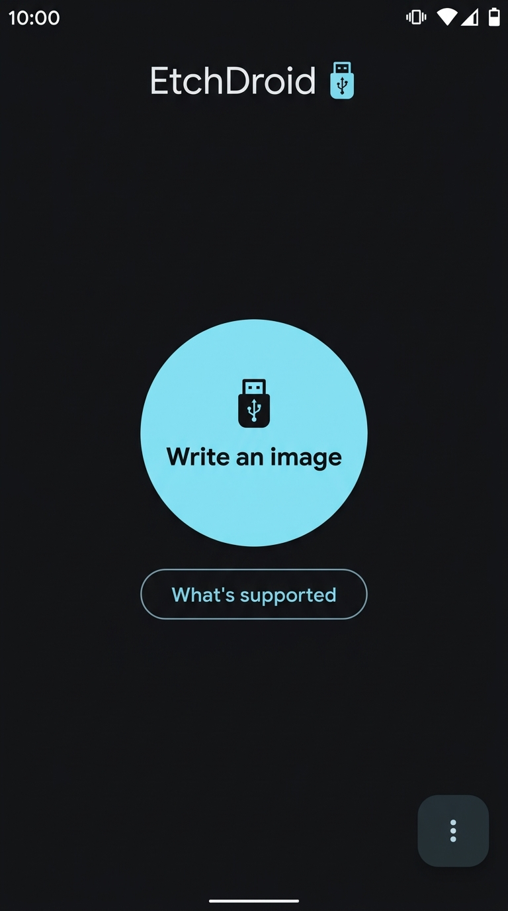
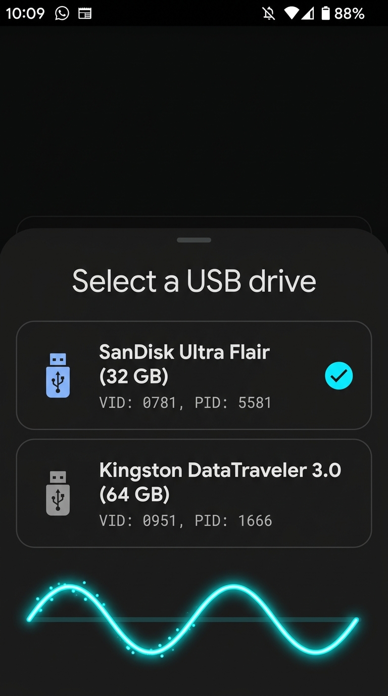
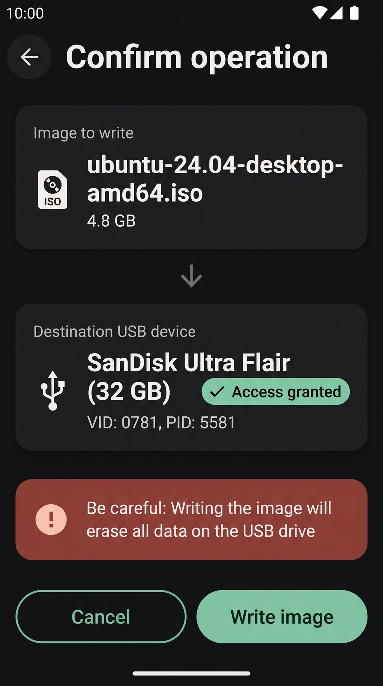
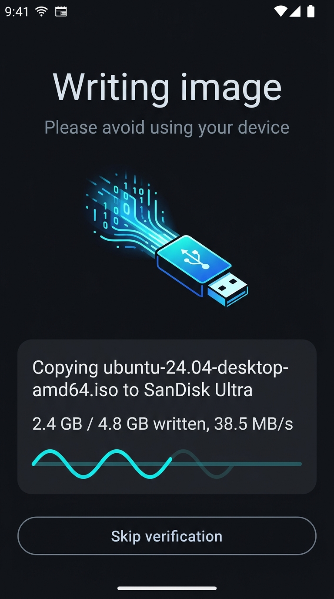
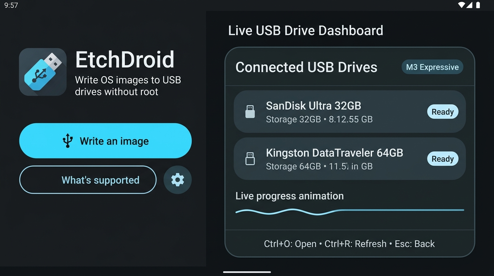

# EtchDroid

   

 <a href="https://github.com/EtchDroid/EtchDroid/releases" rel="noopener"> </a>

EtchDroid is an open-source application that helps you write images to USB drives.

Use it to make a bootable operating system USB drive when your laptop is dead.

### Supported devices

- ✅ USB flash drives
- ✅ USB SD card adapters
- ❌ USB hard drives / SSDs
- ❌ USB docks and hubs
- ❌ Internal SD card slot
- ❌ Optical or floppy disk drives
- ❌ Thunderbolt-only devices

### Supported disk image types

- ✅ Modern GNU/Linux operating system images, including Arch Linux, Ubuntu, Debian, Fedora, pop!_OS,
  Linux Mint, FreeBSD, BlissOS and many more
- ✅ Raspberry PI SD card images (but you must unzip them first!)
- ❌ Official Microsoft Windows ISOs from microsoft.com
- ⚠️ Community-built Windows images, made for EtchDroid (be careful: they may contain viruses!)
- ❌ Apple DMG disk images
- ❌ Older GNU/Linux OS images < 2010 such as Damn Small Linux

## Support the project

If you want to say thanks, you can send a donation.

- Patreon: https://www.patreon.com/depau
- GitHub Sponsors: https://github.com/sponsors/depau
- One-time options on the website: https://etchdroid.app/donate/

## Help out translating EtchDroid

## Telemetry

> [!NOTE]
> F-Droid builds do not include telemetry. Google Play and GitHub builds do.

EtchDroid Google Play and GitHub builds collect minimal telemetry to investigate app issues.

While we don't collect any personally-identifying information, we believe in transparency and want
you to know that opened image file names and USB device IDs are collected anonymously to help
diagnose issues with specific hardware. Unless your image file names or device IDs are highly
sensitive, it's safe to share this data.

If you don't want to share this data, you can disable telemetry in the app menu, or download the
F-Droid version of EtchDroid.

Be a part of our open-source community—keep telemetry enabled and help improve EtchDroid for
everyone!

See the [privacy policy](https://etchdroid.app/privacy/) for more information.

## Screenshots & Modern Material 3 Expressive UI

EtchDroid features **Material 3 Expressive** styling with organic motion, expressive surface container elevation, animated wavy progress indicators, and full adaptability for foldables, tablets, laptops, and desktop displays (with hardware keyboard shortcuts and mouse hover cursor feedback).

### Mobile Phone Layouts

  
  
  
  

| Page | Description |
|:---|:---|
| **Home Screen** | Hero layout with Material 3 Expressive Floating Action Button (`Write an image`), dark/light theme support, and edge-to-edge system bars. |
| **Drive Picker** | Expressive bottom sheet with detected storage device cards (VID/PID) and animated wavy scanning progress indicator. |
| **Confirm Operation** | Clear comparison between source disk image (`.iso`, `.img`) and target USB flash drive with destructive overwrite safety callout. |
| **Flashing Progress** | Live write/verify status with transfer rate (`MB/s`), byte counts, skip verification option, and animated M3 Expressive sinusoidal wavy progress bar. |

### Large Screen, Tablet & Laptop Adaptive Dashboard

When running on Android laptops, tablets, foldables, or desktop environments, EtchDroid automatically shifts to a dual-pane layout:

  

- **Dual-Pane Layout**: Hero controls on the left, live Connected USB Drives dashboard on the right.
- **Mouse & Trackpad Support**: Pointing hand cursor on hover across all interactive buttons, cards, and list items.
- **Accessible Focus Rings**: High-contrast focus borders for D-pad and keyboard navigation (`Tab` / `Shift+Tab`).
- **Hardware Keyboard Shortcuts**:
  - `Ctrl + O` / `Cmd + O`: Open disk image file picker
  - `Ctrl + R` / `F5`: Rescan and refresh connected USB storage drives
  - `Enter`: Confirm and start writing image
  - `Esc`: Cancel or go back
